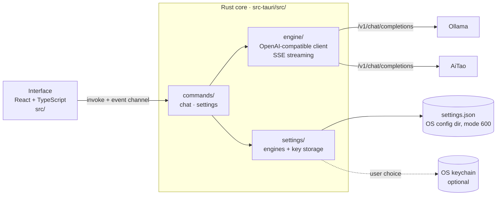

# Liaotao — Architecture

This document explains *how* Liaotao is built, for contributors. The product vision (the
*what* and *why*) is maintained by Aurica Circular outside this repository.

## 1. Overview

Liaotao is a Tauri 2 desktop application. The interface (React) never talks to an engine
directly: it calls Rust commands, and the Rust core makes every network call.

## 2. Engines

Any engine exposing the OpenAI chat API works: `GET {base_url}/models` and
`POST {base_url}/chat/completions` with `stream: true`. Ollama and AiTao both do.

`engine/client.rs` streams one answer and emits `StreamEvent`s (`engine/mod.rs`):

| Event | Meaning |
|---|---|
| `started` | The engine accepted the request |
| `thinking` | A piece of reasoning (`delta.reasoning` / `reasoning_content`), before the answer |
| `delta` | A piece of the answer, to append |
| `finished` | Complete, or stopped by the user; carries the duration and the engine's last raw chunk (AiTao puts sources there) |
| `failed` | The raw error, never rephrased |

Exactly one `finished` or `failed` ends every generation. `engine/sse.rs` reassembles lines
that network chunks may cut anywhere, including inside a UTF-8 character.

**Stop:** each generation has an id and a `tokio::sync::Notify`. `chat_stop` notifies it;
the stream loop `select!`s on it, so a stop takes effect even while the engine is silent.

## 3. Settings and API keys

`settings/store.rs` keeps engines in `settings.json`, in the OS configuration directory
(macOS: `~/Library/Application Support/liaotao/`), never in a synced project folder.
Writes are atomic (temporary file + rename) with mode `600`. Each change is applied to a
copy and becomes current only once written.

API keys (needed by online services only) live where the user chooses:

- **file** (default): inside `settings.json`;
- **keychain**: in the OS credential store, through the `keyring` crate.

Switching moves every key, copying before deleting. **The interface never receives a saved
key**: it sees `has_key`, and the chat sends an `engine_id` that the backend resolves.

## 4. Interface

- `src/features/chat/`: the conversation (`ChatScreen`, `MessageBubble`).
- `src/features/settings/`: engines and key storage.
- `src/hooks/useChatStream.ts`: one streamed answer (text, status, raw error, duration).
- `src/lib/engine.ts`: the typed bridge to every Rust command.
- Every visible text lives in `src/i18n/en.json`; every colour in `tailwind.config.js`.

## 5. Configuration and paths

`config/default.toml` is merged with optional layers (user, project, `APP__*` environment
variables); see [config/schema.md](../config/schema.md). Filesystem paths are built in
`src-tauri/src/paths.rs` only.

## 6. Quality gate

`./verify.sh` is the single judge: build, tests, no hard-coded text or colour, no browser
dialog, files ≤ 350 lines, dependencies equal to the `deps-approved` tag, no secret or
personal path. Tests needing a real Ollama are `#[ignore]` and run with `--live`.

`npm run diag -- <base_url>` prints one line (`UP`/`DOWN` + raw error) for an engine,
without the app: the first step when diagnosing a problem.

Work is split into closed task cards (`docs/TASKS/`) so that routine changes can be
delegated safely; the judge is what makes that safe.
